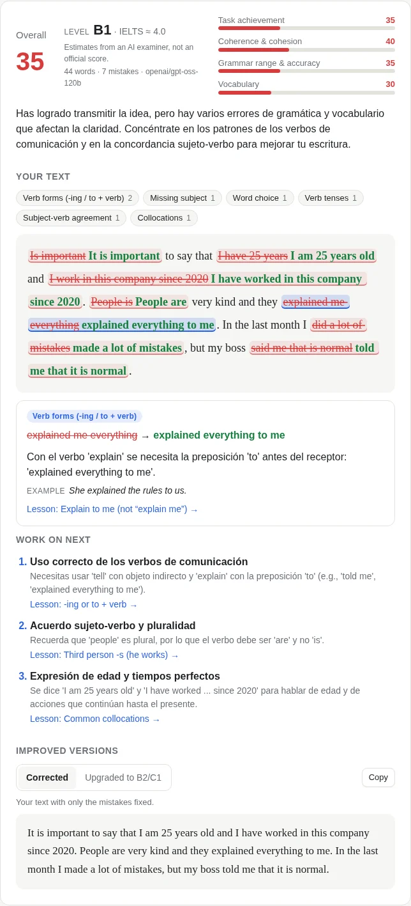
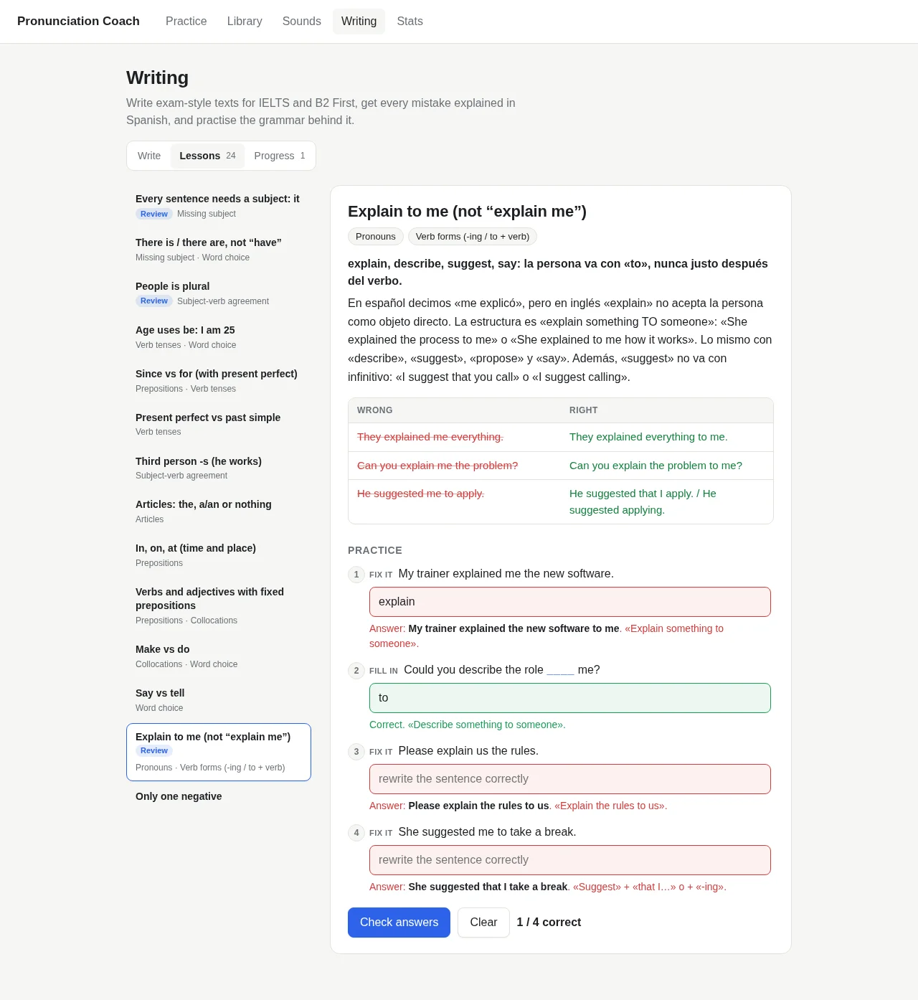
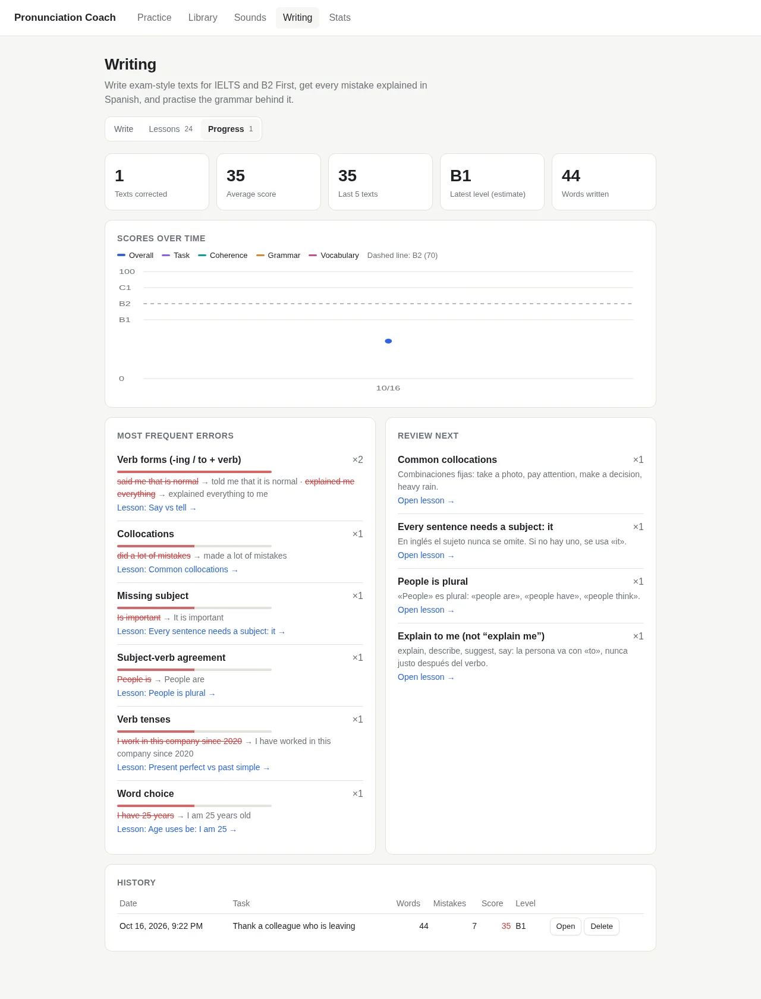

# Pronunciation Coach

**An English coach for Spanish speakers that runs on your own machine.** Read books aloud and
get feedback on every sound you say. Write exam-style texts and get every mistake marked in
place and explained in Spanish. Built for one goal: getting from B1 to B2 (IELTS / Cambridge
B2 First) for work.

```
think: said /t/, expected /θ/        ← pronunciation, phoneme by phoneme
I have 25 years → I am 25 years old  ← writing, with the rule explained in Spanish
```

<p align="center">
  
</p>

## What it does

### Pronunciation: read aloud, sound by sound

- **Read any book.** Upload an EPUB, PDF or TXT, or paste some text. The app splits it into
  sentences and remembers where you stopped.
- **Phoneme-level scoring.** Record a sentence (`Space`) and get an accuracy score, the words
  colored green / amber / red, and specific corrections such as `think: said /t/, expected /θ/`.
- **You vs the model.** After each recording, play your own take, the model voice, or both
  back to back (`C`). Click a word to compare **just that word**: the recognizer's phoneme
  timings cut your word out of the recording and play it next to the model's. The recording
  stays in your browser.
- **Hear the difference.** Click any word to hear it slowly. Click any /sound/ to hear it on
  its own: 41 of 47 sounds are **human recordings** from Wikimedia Commons, not synthetic.
- **Sounds library.** A card for every sound of American English: how to make it (in
  Spanish), the closest Spanish sound, example words and a minimal pair (*think / sink*).
  Sounds that are hard for Spanish speakers are marked.

### Writing: exam practice with a strict AI examiner

- **16 exam-style tasks**: workplace emails, IELTS General Task 1 letters, IELTS Task 2
  essays, B2 First essays, reviews, reports and articles. You can also **generate a new task**
  on any topic.
- **Exam conditions.** Live word count against the target range, an optional countdown with the
  exam time, and spell-check turned off.
- **Every mistake in place.** Each error is struck through with its correction next to it.
  Click it to see the category, the rule **in Spanish**, a new example and the lesson that
  covers it.
- **Scored like the exam.** 0–100 for task achievement, coherence & cohesion, grammar and
  vocabulary, an estimated CEFR level and IELTS band, and the 2–3 things to work on next.
- **Corrected + upgraded.** Your text with only the mistakes fixed, and a B2/C1 rewrite with
  richer vocabulary and linking words to borrow phrases from.
- **24 grammar lessons** on the classic Spanish-speaker traps: *it* as subject, *people is*,
  *I have 25 years*, *since / for*, *make / do*, *say / tell*, *explain me*, articles,
  prepositions, false friends (*actually*, *assist*, *carpet*…), double negatives and more.
  Each lesson has short exercises checked instantly (no AI needed).
- **Progress.** Scores over time against the B2 line, your most frequent error categories,
  and the lessons to review based on your last 5 texts.

| Lessons | Progress |
| --- | --- |
|  |  |

## Quick start with Docker

```sh
git clone https://github.com/Leonard-Hernandez/pronunciation-coach.git
cd pronunciation-coach
docker compose up -d --build
```

Open <http://127.0.0.1:8765> and allow microphone access. That's it.

- **Data** (database, voices, speech model) lives in the `coach-data` volume, so it survives
  rebuilds. The first recording downloads the recognizer (~1.2 GB) and the first "Listen"
  downloads the Piper voice (~63 MB).
- **Writing correction** needs a free [Groq API key](https://console.groq.com/keys). Compose
  reads it from `~/.config/pronunciation-coach/env` (see [Writing setup](#writing-setup-groq)),
  or you can export `GROQ_API_KEY` before `docker compose up`. Without a key, everything else
  works.
- **GPU (optional).** The default image runs on CPU, which is fast enough for one sentence at
  a time. For NVIDIA: install the NVIDIA Container Toolkit, uncomment the `deploy:` block in
  `compose.yaml` and run `PC_VARIANT=cuda docker compose up -d --build`.

Plain Docker, without Compose:

```sh
docker build -t pronunciation-coach .
docker run -d -p 127.0.0.1:8765:8765 -v coach-data:/data \
  -e GROQ_API_KEY=gsk_... pronunciation-coach
```

## Run from source

Requirements: [uv](https://docs.astral.sh/uv/), `espeak-ng` and `ffmpeg` from your system
packages. Python 3.12 is pinned and installed by uv. An NVIDIA GPU is optional: PyTorch comes
from the CUDA 12.8 index, which RTX 50 / Blackwell cards need.

```sh
uv sync
uv run pronunciation-coach     # http://127.0.0.1:8765
```

## Writing setup (Groq)

Put your key in `~/.config/pronunciation-coach/env`, outside the repo:

```sh
mkdir -p ~/.config/pronunciation-coach
echo 'GROQ_API_KEY=gsk_...' > ~/.config/pronunciation-coach/env
chmod 600 ~/.config/pronunciation-coach/env
```

A `GROQ_API_KEY` environment variable takes precedence. The key is read on demand and never
logged.

- **Model.** The default is `openai/gpt-oss-120b`, a large reasoning model with strict
  structured output. If it is rate-limited or unavailable, the app switches to
  `openai/gpt-oss-20b`. If both are rate-limited, the UI tells you how long to wait.
  A correction usually takes 5–10 s.
- **Robust highlights.** The model returns strict JSON (validated with pydantic and retried once
  if invalid). Each mistake quotes the exact text plus which occurrence it is, and the server
  maps it back to character offsets: exact match first, then ignoring case, quotes and spaces,
  then a fuzzy match. Anything it cannot place is listed under "Other notes" instead of being
  highlighted in the wrong place.
- **Swappable provider.** The LLM call sits behind a small interface (`llm.py`), so another
  provider can be added without touching the rest.

## How pronunciation scoring works

1. **Expected sounds.** `phonemizer` + espeak-ng (`en-us`) turn the sentence into IPA phonemes,
   word by word.
2. **What you said.** `facebook/wav2vec2-lv-60-espeak-cv-ft`, a CTC phoneme recognizer trained on
   espeak IPA, transcribes your recording into phonemes.
3. **Comparison.** Both sequences are normalized to the same symbol set, aligned with
   Needleman-Wunsch and mapped back to words. Close vowel pairs (/i/–/ɪ/, /ə/–/ʌ/…) get half
   credit.
   - Word status: good ≥ 80%, unsure 50–80%, bad < 50%.
   - Sentence accuracy = matched phonemes / (expected phonemes + 0.5 × extra phonemes).

The recognizer runs in a **separate worker process** (GPU if available). It starts with the
first recording and exits after 120 s idle, which frees the CUDA context so a laptop dGPU can
go back to sleep. The web server process never imports torch.

**Text-to-speech** uses [Piper](https://github.com/OHF-Voice/piper1-gpl) (`en_US-lessac-medium`)
on the CPU, with an in-memory cache and an espeak-ng fallback. **Isolated sounds** come from
the most natural source available: a human recording (bundled in `static/phonemes/`, ~0.7 MB,
credits in `ATTRIBUTION.md` and on each card), then the sound inside an example word spoken by
Piper, then espeak-ng. To refetch the recordings (needs network and ffmpeg):

```sh
uv run python scripts/fetch_phoneme_audio.py        # all sounds
uv run python scripts/fetch_phoneme_audio.py θ ð    # only some
```

## Privacy

Pronunciation runs entirely on your machine: your recordings never leave it. The only
downloads are the models and voice. Writing is the exception: the text you submit for
correction (and the topic of a generated task) is sent to Groq.

## Configuration

| Variable | Default | Meaning |
| --- | --- | --- |
| `PC_HOST` / `PC_PORT` | `127.0.0.1` / `8765` | Bind address (`0.0.0.0` in Docker) |
| `PC_DATA_DIR` | `~/.local/share/pronunciation-coach` | SQLite database and Piper voices (`/data` in Docker) |
| `PC_CONFIG_DIR` | `~/.config/pronunciation-coach` | Where the `env` file with `GROQ_API_KEY` lives |
| `PC_TTS_VOICE` | `en_US-lessac-medium` | Piper voice (from `rhasspy/piper-voices`) |
| `PC_DEVICE` | `auto` | Recognizer device: `auto`, `cuda` or `cpu` |
| `PC_WORKER_IDLE_TIMEOUT` | `120` | Seconds before the recognizer worker exits |
| `PC_MODEL` | `facebook/wav2vec2-lv-60-espeak-cv-ft` | Recognizer model |
| `PC_WRITING_PROVIDER` | `groq` | LLM provider for Writing |
| `PC_WRITING_MODEL` | `openai/gpt-oss-120b` | Model for corrections and task generation |
| `PC_WRITING_FALLBACK_MODEL` | `openai/gpt-oss-20b` | Used when the main model is rate-limited or down (empty to disable) |
| `PC_WRITING_REASONING_EFFORT` | `medium` | `low`, `medium` or `high` (gpt-oss models only) |
| `PC_WRITING_TIMEOUT` | `120` | Seconds before an LLM request is abandoned |

## Tests

```sh
uv run pytest
```

The tests use a fake lexicon, recognizer, synthesizer and LLM provider. They need no GPU, no
espeak-ng, no model or voice download, and no API key.

## Project layout

```
src/pronunciation_coach/
  server.py           FastAPI app + entry point (never imports torch)
  worker.py           recognizer worker process and its client (lazy spawn, idle exit)
  phonemes.py         espeak phonemization and IPA normalization
  scoring.py          alignment, per-word scores, error reports
  tts.py              Piper TTS with espeak-ng fallback, LRU audio cache
  phoneme_guide.py    per-phoneme teaching content (single source)
  phoneme_audio.py    bundled human recordings and which source plays each sound
  tips.py             Spanish-speaker pronunciation tips
  books.py            EPUB/PDF/TXT extraction, sentence splitting
  audio.py            ffmpeg decoding to 16 kHz mono
  llm.py              LLM provider interface + Groq provider
  writing.py          correction/task prompts, schemas, highlight location
  writing_tasks.py    library of exam-style writing tasks
  grammar_lessons.py  grammar lessons, error categories, exercise checking (single source)
  db.py               SQLite: books, attempts, writing submissions, stats
  static/             single-page frontend (vanilla HTML/CSS/JS, no build step)
scripts/fetch_phoneme_audio.py   refetch the recordings from Wikimedia Commons
Dockerfile, compose.yaml         container image (CPU by default, CUDA optional)
```

## Limitations

- The pronunciation score measures how close you are to espeak's American English. It does not
  cover intonation, rhythm or word stress, and other valid accents can be marked as errors.
- The recognizer sometimes hears what you meant instead of what you said, and it is less
  reliable with background noise. Trust patterns across many attempts more than single errors.
- Writing scores, CEFR levels and IELTS bands are **AI estimates**, not official results. The
  model can miss a mistake or flag a correct sentence. Use the explanations to learn, and check
  anything that seems wrong against the lessons.
- PDF extraction depends on the PDF. Scanned PDFs are not supported, and headers or footers may
  end up in sentences.

## Credits

Isolated-sound recordings come from Wikipedia's IPA articles via Wikimedia Commons
(CC BY-SA / CC0 / public domain; see `src/pronunciation_coach/static/phonemes/ATTRIBUTION.md`).
Speech synthesis by Piper and espeak-ng. Phoneme recognition by wav2vec2 (Facebook AI).
